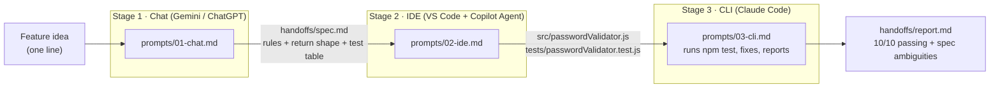
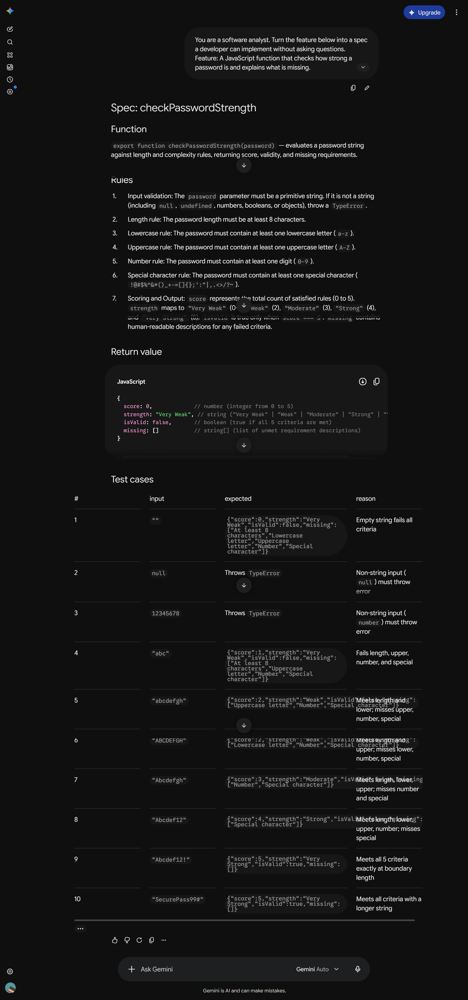
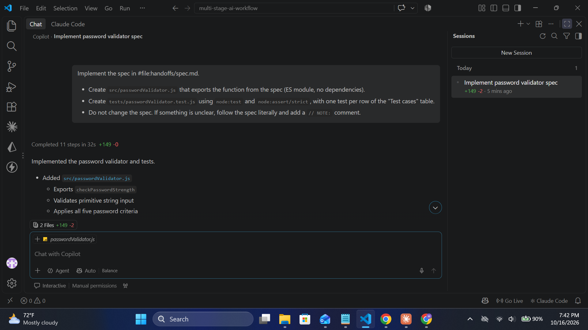
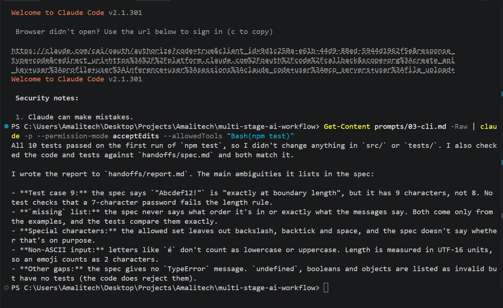

# Multi-Stage AI Workflow: Feature Idea → Tested Code

A workflow that chains three AI UX types (**Chat → IDE → CLI**). It turns a one-line feature idea into a spec, then working code with tests, then a verification report. Each stage's output file is the next stage's input.

The example feature is a JavaScript password strength validator (`checkPasswordStrength`).

## Workflow diagram



## Project structure

```
prompts/       01-chat.md, 02-ide.md, 03-cli.md   reusable prompt templates (one per stage)
handoffs/      spec.md (Stage 1 output), report.md (Stage 3 output)
src/           passwordValidator.js               generated in Stage 2
tests/         passwordValidator.test.js          generated in Stage 2
screenshots/   evidence of each stage
```

## Handoff contract

These fixed formats are what make the chain work, whichever tools you use:

| Handoff | Produced by | Consumed by | Format |
|---|---|---|---|
| `handoffs/spec.md` | Chat | IDE | Markdown with fixed sections: Function, Rules, Return value, Test cases table |
| `src/` + `tests/` | IDE | CLI | ES module + `node:test` file, one test per spec row |
| `handoffs/report.md` | CLI | Human | Test result, fixes made, spec ambiguities |

`spec.md` is the **source of truth**. Later stages are told not to edit it.

## Step-by-step

**Requirements:** Node.js 18+, a chat AI, an IDE with an AI agent, and an AI CLI. No npm packages are needed.

### Stage 1 · Chat → `spec.md`
1. Open a new chat in Gemini or ChatGPT.
2. Paste the contents of [prompts/01-chat.md](prompts/01-chat.md). To use a different feature, edit the `Feature:` line.
3. Save the reply as `handoffs/spec.md`.

Result: a spec with 7 rules, a return shape, and 10 test cases.


### Stage 2 · IDE → code + tests
1. Open the project in VS Code, then open Copilot Chat in **Agent** mode.
2. Paste the contents of [prompts/02-ide.md](prompts/02-ide.md). It attaches the spec with `#file:handoffs/spec.md`.
3. Review the two new files and accept them. Don't let Copilot run the tests; that's Stage 3's job.

Result: Copilot created both files in 32 seconds (11 steps).


### Stage 3 · CLI → verified code + `report.md`
Run from the project root in a terminal:

```bash
Get-Content prompts/03-cli.md -Raw | claude -p --permission-mode acceptEdits --allowedTools "Bash(npm test)"
```

The CLI runs `npm test`. If tests fail, it fixes `src/` or `tests/` using the spec as the reference, re-runs them, and writes `handoffs/report.md`.

Result: 10/10 tests passed with no fixes needed. The report flagged 8 spec ambiguities, for example that test 9's "boundary length" input is actually 9 characters, and that no 7-character case is tested.


### Run the tests yourself
```bash
npm test
```

## Adaptability

The prompts are plain Markdown and the handoffs are plain files, so each stage can swap tools without other changes:

| Stage | Used | Drop-in alternatives |
|---|---|---|
| Chat | Gemini | ChatGPT, Claude.ai, Copilot Chat |
| IDE | VS Code + GitHub Copilot | Cursor, Windsurf, JetBrains AI |
| CLI | Claude Code | Gemini CLI, Codex CLI, Aider |

Nothing in the prompts names a specific tool or model. The only tool-specific detail is how the prompt gets in: `#file:` in Copilot, and the CLI flags in Stage 3. To reuse the workflow for another feature, change the `Feature:` line in Stage 1 and the file names in Stage 2.

## Efficiency

The times below are estimates for this feature, except the Copilot run time, which was measured.

| Task | Manual | With workflow |
|---|---|---|
| Write a spec with rules and 10 test cases | ~20 min | ~2 min (paste + save) |
| Implement the function + 10 tests | ~30 min | ~2 min (32 s generation + review) |
| Run tests, debug, write a review report | ~15 min | ~1 min (one command) |
| **Total** | **~65 min** | **~5 min of hands-on time** |

The human's job shifts from writing to **reviewing**. The fixed handoff format also means no re-explaining between tools: each stage reads the previous file instead of a copy-pasted conversation.

## Limitations

- Stages 1 and 2 still need a human to copy, paste and review. Only Stage 3 is a single command.
- AI output varies between runs. The fixed spec format and "spec is the source of truth" rule keep it consistent, but always check the report.
